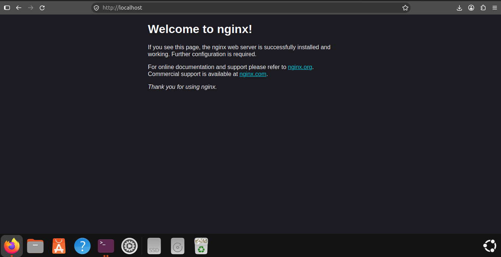
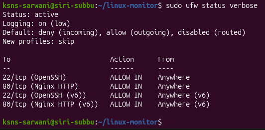
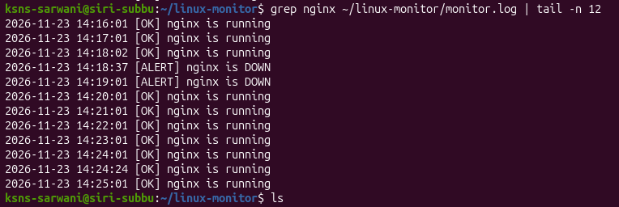

# Linux Server Setup & Monitoring

A hands-on project where I set up a web server on Ubuntu, secured it with SSH keys and a firewall, and wrote a Bash script that monitors system health and runs automatically through cron.

Tested on: 26.04.1 LTS (local machine, not a production server).

## What it does
- Serves a web page using **Nginx**
- Allows only key-based **SSH** login (password and root login disabled)
- Uses the **UFW firewall** with default-deny for incoming traffic, allowing only SSH (22) and HTTP (80)
- Runs `monitor.sh` every 5 minutes via **cron** to check:
  - Disk usage (alert at 80% or more)
  - Memory usage (alert at 80% or more)
  - Whether the `nginx` and `ssh` services are running
- Writes timestamped `OK` / `ALERT` lines to `monitor.log`

## Tools used
Ubuntu, Nginx, OpenSSH, UFW, Bash, awk, systemd (`systemctl`), cron, Git

## Setup summary
1. **Nginx:** `sudo apt install nginx`, verified with `systemctl status nginx` and `curl localhost`
2. **SSH keys:** `ssh-keygen -t ed25519`, `ssh-copy-id`, then set `PasswordAuthentication no` and `PermitRootLogin no`
3. **Firewall:** `ufw default deny incoming`, allowed OpenSSH and Nginx HTTP, then `ufw enable`
4. **Monitoring script:** `monitor.sh`
5. **Automation:** cron entry `*/5 * * * * /home/ksns-sarwani/linux-monitor/monitor.sh`

## Usage
```bash
chmod +x monitor.sh
./monitor.sh
cat monitor.log
```

## Sample output (nginx stopped, then restored)
```
2026-11-23 14:18:02 [OK] nginx is running
2026-11-23 14:18:37 [ALERT] nginx is DOWN
2026-11-23 14:19:01 [ALERT] nginx is DOWN
2026-11-23 14:20:01 [OK] nginx is running
```

## Screenshots
| Nginx page | UFW status | Log with an ALERT |
|---|---|---|
|  |  |  |

## What I learned
- Managing services with `systemctl` and reading logs in `/var/log`
- Why SSH keys are safer than passwords
- Firewall rules are checked in order, so an earlier allow rule overrides a later deny (I saw this when `deny 80` had no effect)
- Using `awk` to extract values from `df` and `free` output
- Bash variables, functions, `if` statements, loops and exit codes
- Scheduling jobs with cron, and why it needs full paths

## Limitations and future improvements
- Runs on a personal machine, not a hardened production server
- Possible additions: email alerts, auto-restarting a failed service, CPU checks and log rotation
